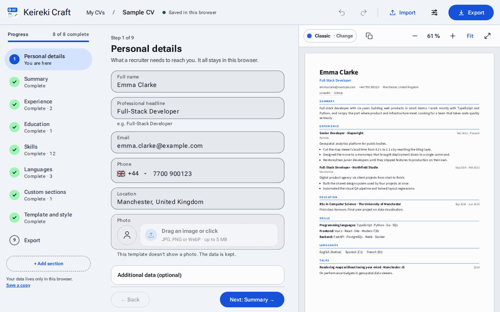
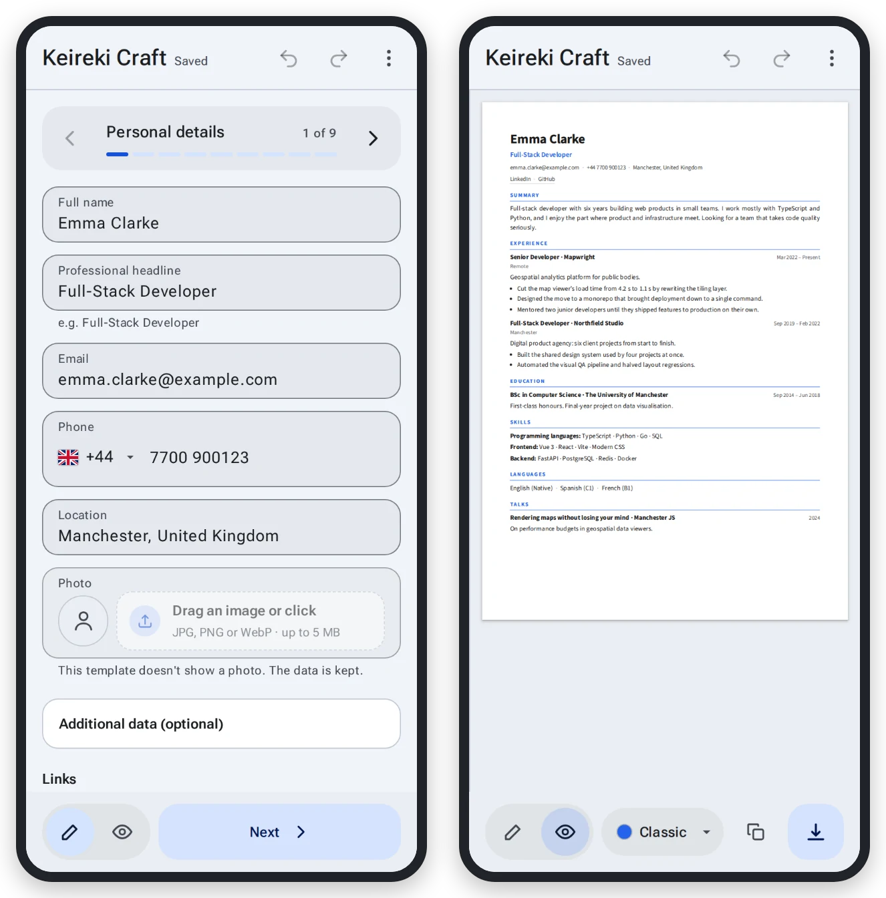
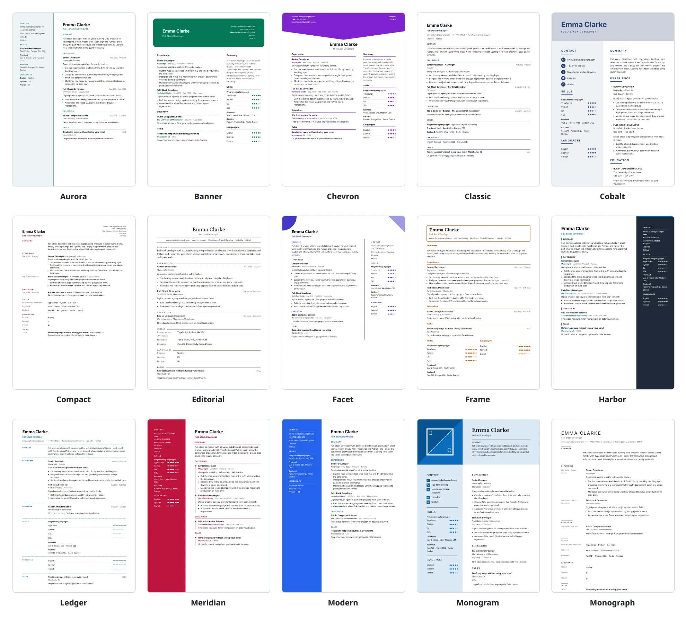

<div align="center">


# Keireki Craft

**A CV editor that runs entirely in your browser.**<br>
No account, no server, no upload: write, preview and export your CV, and it never leaves your device.

[**Open the app**](https://dav1ddq0.github.io/vue-cv-maker/) · [Features](#features) · [Templates](#templates) · [Development](#development)

[](https://github.com/dav1ddq0/vue-cv-maker/actions/workflows/deploy.yml)
[](./LICENSE)




</div>

## Features

- **Guided writing.** Nine short steps (personal details, summary, experience, education, skills,
  languages, your own sections, style, export), with a live preview that follows every keystroke.
  Sections can be reordered, and undo/redo covers every change.
- **15 templates.** One or two columns, with or without a photo, ATS-friendly ones included.
  Switching never deletes anything: what a template cannot show is kept for the next one.
- **Your style.** Accent colour, typeface, font size, spacing and page margins; the photo is framed
  in a crop dialog.
- **Export.** PDF as a direct download or through the print dialog, an image (JPG), HTML and JSON.
  **Copy image** puts the whole CV on the clipboard to paste anywhere.
- **Import.** A JSON exported before, or an existing CV as a PDF: its text is read in the browser,
  sorted into sections, and shown for review before anything is applied. The imported CV takes the
  language of the PDF.
- **Six languages.** The interface and the CV in English, Spanish, French, Italian, Portuguese and
  German, with a sample CV in each.
- **Several CVs.** Keep as many as you need, each saved as you type.
- **Phone and tablet.** A layout of its own on small screens: one step at a time, the preview a tap
  away. Light and dark themes.
- **Improve with AI, on your terms.** A button opens Claude, ChatGPT or Gemini in a new tab with a
  ready prompt for that one text. Only when you choose an assistant; the app itself calls none.

<div align="center">

</div>

## Templates

<picture>
  <source media="(prefers-color-scheme: dark)" srcset="docs/images/templates-dark.webp">
  
</picture>

Every template is a single Vue component used for the preview, the HTML and both PDFs, so what you
see is what you export. [Adding one](#adding-a-template) takes one folder.

## Privacy

Your CV is stored in your browser's IndexedDB and nowhere else. There is no backend, no account and
no analytics. The app makes two requests of its own, both optional to how it works:

- The phone field asks [`ipwho.is`](https://ipwho.is) for the country of your connection to
  preselect the dialling code. The answer holds no IP address, nothing is stored, and if it fails the
  editor works the same.
- **Improve with AI** opens the assistant you pick in a new tab, with the text of that one field in
  the link. Nothing is sent until you choose.

A strict Content-Security-Policy is added to the build, and hostile files (scripts in every field,
PDFs with JavaScript) are part of the test suite. Export the JSON from time to time: a browser can
clear site data when it runs out of space, and the app warns you about it.

## Development

```bash
npm install
npm run dev           # http://localhost:5173/vue-cv-maker/
npm test              # unit tests (Vitest)
npm run typecheck     # vue-tsc
npm run build         # type-check + production bundle into dist/
```

Browser checks on the built site, with Playwright (each builds first):

| Command | What it checks |
|---|---|
| `npm run qa:e2e` | End-to-end flows and performance budgets in Chromium |
| `npm run qa:consistency` | Every view against the design tokens, on laptops, tablets and phones, light and dark |
| `npm run qa:pdf` | The direct PDF against the printed one, template by template |
| `npm run qa:roundtrip` | Upload → export every way → import again, nothing lost |
| `npm run qa:security` | Hostile JSON and PDF files: nothing runs, nothing leaves the page |
| `npm run qa` | All of the above |

### Stack

Vue 3 (`<script setup>`) · TypeScript · Vite · Pinia · IndexedDB through
[`idb-keyval`](https://github.com/jakearchibald/idb-keyval) · [pdf.js](https://mozilla.github.io/pdf.js/)
for PDF import and the JPG · [PDFKit](https://pdfkit.org/) for the direct PDF ·
[paged.js](https://pagedjs.org/) for print pagination · Vitest and Playwright.

### How the project is built

Every feature starts as a spec in [`spec/`](./spec/README.md): what it does and how it is checked,
then a task list, one small commit per task. [`spec/constitution/`](./spec/constitution/) holds the
mission, the stack rules and the [roadmap](./spec/constitution/roadmap.md) of everything done so far.
The original product spec is [`spec-cv-editor-en.md`](./spec-cv-editor-en.md).

## Architecture

```
src/
├── types/cv.ts          the central contract — everything else depends on it
├── core/                model factories, schema migrations, history, debounce
├── stores/              cv (data + undo/redo + autosave), ui (view state)
├── services/
│   ├── storage/         StorageAdapter interface + IndexedDB implementation
│   ├── export/          render → HTML / print / direct PDF / image / JSON
│   └── pdfImport/       extract (pdf.js) → analyze (heuristics) → assemble
├── templates/           one folder per template, auto-registered
├── components/          form (wizard steps), preview, import, documents, ui
├── composables/         reusable stateful logic
└── i18n/                the six interface languages
```

Four rules hold the design together, and each has a test guarding it:

1. **One source of truth per template.** A single `.vue` component serves the
   live preview, the printable HTML and the PDF. `services/export/render.ts`
   mounts it off-screen for the non-interactive outputs.
2. **Templates are pure.** Exactly one prop (`data: CVData`), no store access, no
   mutation, no hardcoded colors or fonts. Enforced by
   `tests/templateContract.test.ts`.
3. **Data is never lost.** A template that lacks a capability *ignores* the
   related data; switching back restores it. Imports and migrations fill missing
   fields rather than dropping unknown ones.
4. **paged.js is encapsulated.** It appears in `services/export/pdf.ts` and
   nowhere else, always on a container outside the Vue-managed tree, and plain
   `window.print()` remains a complete fallback if it is dropped.

### Adding a template

Create `src/templates/<id>/` with an `index.ts` default-exporting a
`TemplateDefinition` and a `Template.vue` taking `data: CVData`. The registry
picks it up through `import.meta.glob` — no existing file changes. The contract
test suite runs against it automatically.

Declare only the capabilities the template actually renders (`photo`, `sidebar`,
`accentColor`, `customFont`, `multiPage`); the wizard dims the controls it cannot
honour and keeps the data untouched.

### Storage

| Key | Contents |
|---|---|
| `cv:{id}` | the full `CVData` |
| `photo:{id}:{version}` | the photo as a `Blob` |
| `index` | `CVSummary[]` for the document list |

Photos are stored as blobs (≈33% smaller than base64) and resolved to object URLs
at render time. Exported JSON inlines the photo as base64 so the file stays
self-contained. `localStorage` holds only UI preferences.

Private browsing and quota failures are detected and surfaced, and the app asks
for `navigator.storage.persist()` on startup.

### PDF import

Three stages, all client-side:

1. **Extract** — `pdf.js` text fragments grouped into lines by Y coordinate,
   keeping font size and weight.
2. **Analyze** — direct fields by regex; section headings, months, "present" and
   language levels in all six languages; name by largest first-page text; section
   headers by keyword + size + weight + line shape. Pure functions, no DOM.
3. **Review** — nothing is applied silently. Low-confidence fields are flagged,
   unclassified blocks default to *discard*, and the full raw text is always
   available.

Two-column and heavily designed CVs extract badly; the review screen is what makes
an imperfect extraction useful. Scanned PDFs are detected and reported — OCR is
out of scope.

## Browser support

Chromium-based browsers and Firefox. The QA suite runs in Chromium; Firefox is checked by hand.
Safari's limits are handled (the canvas size cap on iOS, the clipboard needing the click), but
Safari is not in the automated runs. The direct PDF download does not go through the browser's
print engine, so it comes out the same everywhere; printing differs slightly between browsers.

## Deployment

Published at <https://dav1ddq0.github.io/vue-cv-maker/> by `.github/workflows/deploy.yml`: every
push to `main` installs, runs the tests, builds and deploys to GitHub Pages. A red test suite blocks
the deploy.

- **One-time setup:** repository *Settings → Pages → Build and deployment → Source: GitHub Actions*.
- **Base path:** `vite.config.ts` defaults to `/vue-cv-maker/`, the project-site path, so
  `npm run preview` behaves like production. Set `BASE_PATH` to build for another location, for
  example `BASE_PATH=/ npm run build` for a user site or a custom domain.
- **Content-Security-Policy:** the build adds a CSP `<meta>` tag (GitHub Pages cannot send headers);
  it is not applied by `npm run dev`.

The README's images are generated from the built app by `docs/readme-media.cjs`
(`npm run build && node docs/readme-media.cjs`; it needs Python's Pillow for the GIF).

## License and credits

[MIT](./LICENSE).

- Country flags: [flag-icons](https://github.com/lipis/flag-icons) © 2013 Panayiotis Lipiridis, MIT License.
